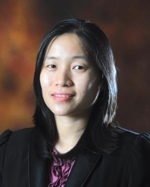

::: {.speaker}

::: {}
### Prof Dr Kamarul Imran Musa (KIM)

Professor of Epidemiology and Biostatistics at the School of Medical Sciences, Universiti Sains Malaysia. A medical epidemiologist and statistician, KIM teaches R, Quarto and reproducible data analysis for health research.
:::
:::

::: {.speaker}

::: {}
### Assoc Prof Dr Kueh Yee Cheng (Erica)

Biostatistician at the School of Medical Sciences, Universiti Sains Malaysia. Erica teaches biostatistics and research methodology, with work in statistical modelling and forecasting for health research.
:::
:::
